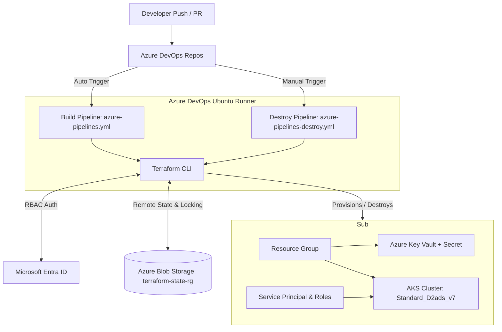
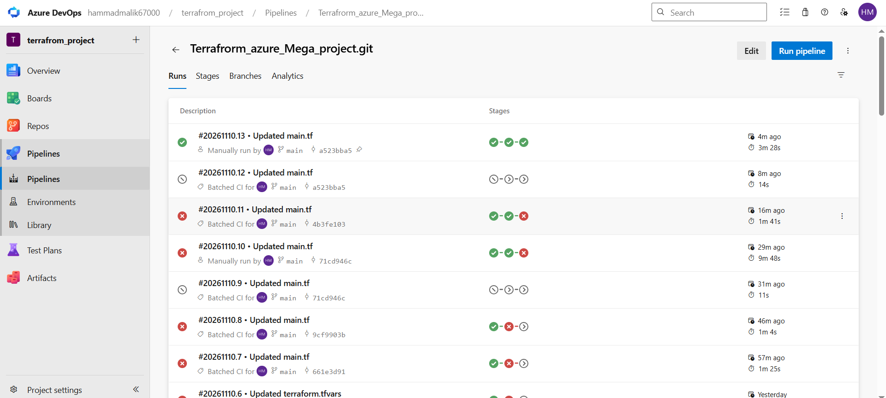
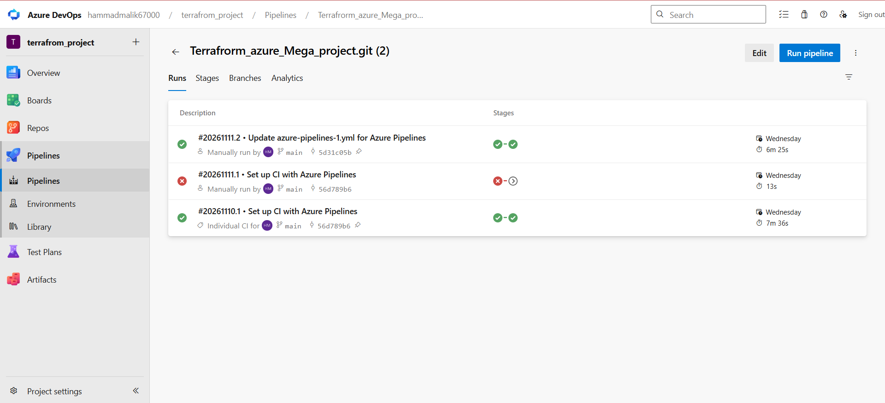

# Multi-Environment Azure Kubernetes Service (AKS) Deployment with Terraform & Azure DevOps

An automated Infrastructure-as-Code (IaC) project that builds and destroys isolated **Dev** and **Staging** Azure Kubernetes Service (AKS) environments using modular **Terraform** and **Azure DevOps YAML Pipelines**.

---

## Project Overview

* **What It Does:** Automatically creates and tears down complete Kubernetes environments on Microsoft Azure without manual clicking in the Azure Portal.
* **Why It Matters:** Keeps `dev` and `staging` environments identical, enforces pull-request validation before deployment, and prevents unexpected cloud bills with a one-click teardown pipeline.
* **Core Tools Used:**
  * **Terraform:** Defines all Azure cloud resources as reusable code.
  * **Azure DevOps Pipelines:** Runs automated validation, deployment, and cleanup workflows on Ubuntu agents.
  * **Azure Blob Storage:** Stores remote `.tfstate` files with state locking.
  * **Microsoft Entra ID (Azure AD):** Manages Service Principals and Role-Based Access Control (RBAC).
  * **Azure Key Vault:** Securely stores generated Service Principal secrets.
  * **Azure Kubernetes Service (AKS):** Runs scalable Kubernetes clusters (`Standard_D2ads_v7` nodes).

---

## Architecture Diagram



---

## Key Features Implemented

* **Modular Terraform Design:** Reusable child modules (`aks`, `keyvault`, and `ServicePrincipal`) prevent code duplication across environments.
* **Isolated Remote State:** Separate Azure Storage Accounts (`tfdevbackendhammad2026` and `tfstagebackendhammad2026`) keep `dev` and `staging` state files completely separate.
* **Passwordless State Auth:** Uses Microsoft Entra ID RBAC (`Storage Blob Data Contributor`) instead of hardcoded storage access keys.
* **Branch-Based CI/CD Gates:**
  * **Feature Branches (`feature/*`):** Runs `terraform validate` only as a safe pull-request check.
  * **Main Branch (`main`):** Automatically validates, deploys `dev`, and then deploys `staging` in sequence.
* **FinOps Teardown Pipeline:** A manually triggered destroy pipeline lets you pick `dev` or `staging` from a dropdown to safely delete expensive AKS clusters while keeping the backend storage intact.

---

## Repository Structure

```text
├── dev/                          # Development environment root configuration
│   ├── .ssh/id_rsa.pub           # Public SSH key for Dev AKS worker nodes
│   ├── backend.tf                # Remote state config for Dev storage account
│   ├── main.tf                   # Wires Resource Group, SPN, Key Vault, and AKS
│   ├── variables.tf              # Input variable declarations
│   └── terraform.tfvars          # Dev environment values (names, region)
├── staging/                      # Staging environment root configuration
│   ├── .ssh/id_rsa.pub           # Public SSH key for Staging AKS worker nodes
│   ├── backend.tf                # Remote state config for Staging storage account
│   ├── main.tf                   # Staging infrastructure orchestration
│   ├── variables.tf              # Input variable declarations
│   └── terraform.tfvars          # Staging environment values
├── modules/                      # Reusable Terraform building blocks
│   ├── aks/                      # AKS cluster (dynamic K8s version, OIDC, autoscaling)
│   ├── keyvault/                 # Azure Key Vault setup and access permissions
│   └── ServicePrincipal/         # Entra ID Application and Service Principal creation
├── images/                       # Pipeline execution screenshots
├── azure-pipelines.yml           # Multi-stage CI/CD build & deploy pipeline
├── azure-pipelines-destroy.yml   # Parameterized infrastructure destroy pipeline
└── .gitignore                    # Blocks local state, .terraform cache, and private keys
```

---

## Pipeline Screenshots

### 1. Build & Deployment Pipeline (`azure-pipelines.yml`)
*Shows all three stages (`validate`, `dev_deploy`, and `stage_deploy`) completing cleanly on `main`.*



### 2. Parameterized Destroy Pipeline (`azure-pipelines-destroy.yml`)
*Shows `plan_destroy` and `destroy_env` tearing down cloud resources safely.*



---

## How to Run This Project

* **Step 1: Bootstrap Remote State Storage.** Create a resource group (`terraform-state-rg`) and two `Standard_LRS` storage accounts (`tfdevbackendhammad2026` and `tfstagebackendhammad2026`) with a `tfstate` blob container in each.
* **Step 2: Configure Azure DevOps Permissions.** Create an Azure Resource Manager Service Connection and grant its App Registration:
  * `Storage Blob Data Contributor` on `terraform-state-rg`
  * `User Access Administrator` and `Key Vault Secrets Officer` on your Azure Subscription
* **Step 3: Deploy Infrastructure.** Replace `<YOUR_SUBSCRIPTION_ID>` in both YAML files with your Azure Subscription ID, push to `main`, and watch `azure-pipelines.yml` deploy `dev` and `staging`.
* **Step 4: Clean Up Resources.** Run `azure-pipelines-destroy.yml` manually in Azure DevOps, select `dev` or `staging`, and destroy the clusters when finished testing.
